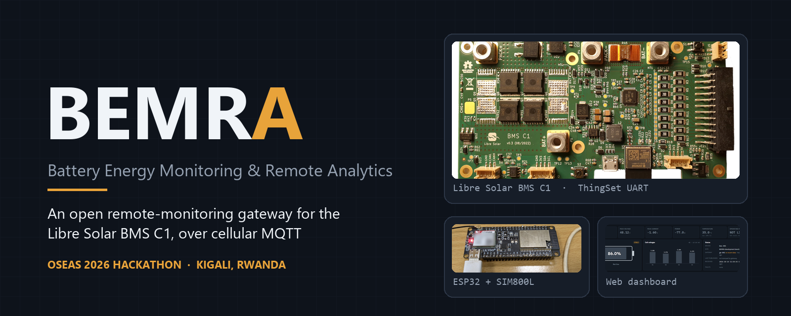
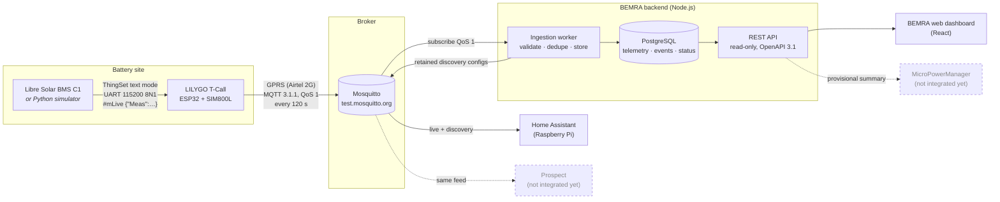
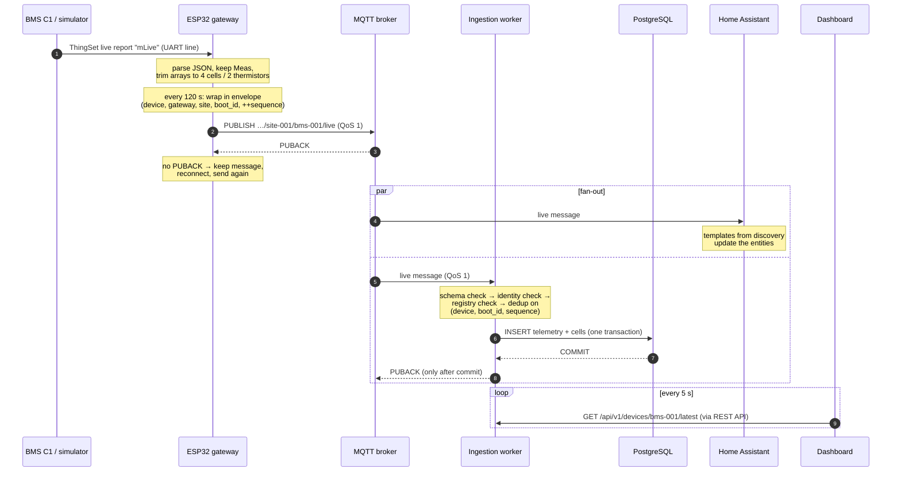
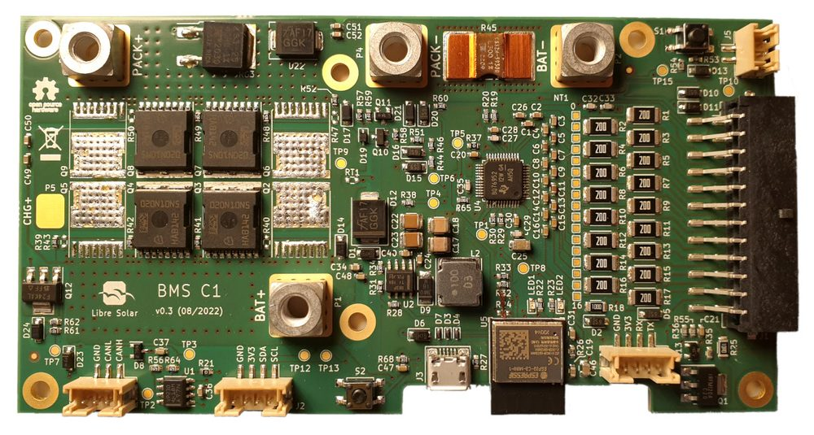
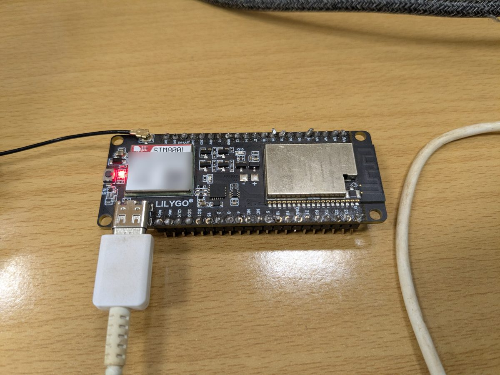
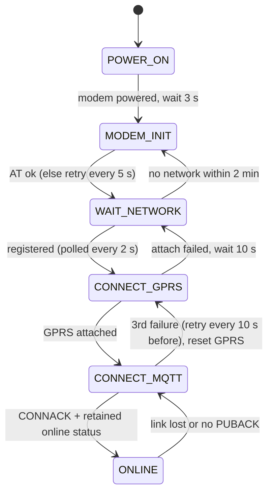
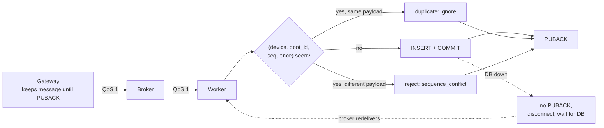
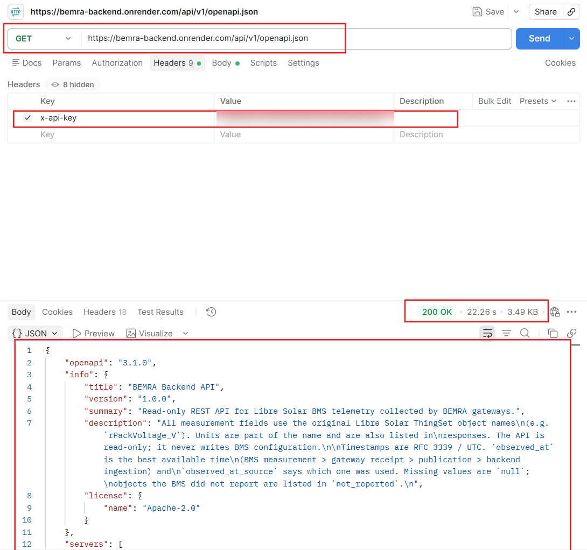
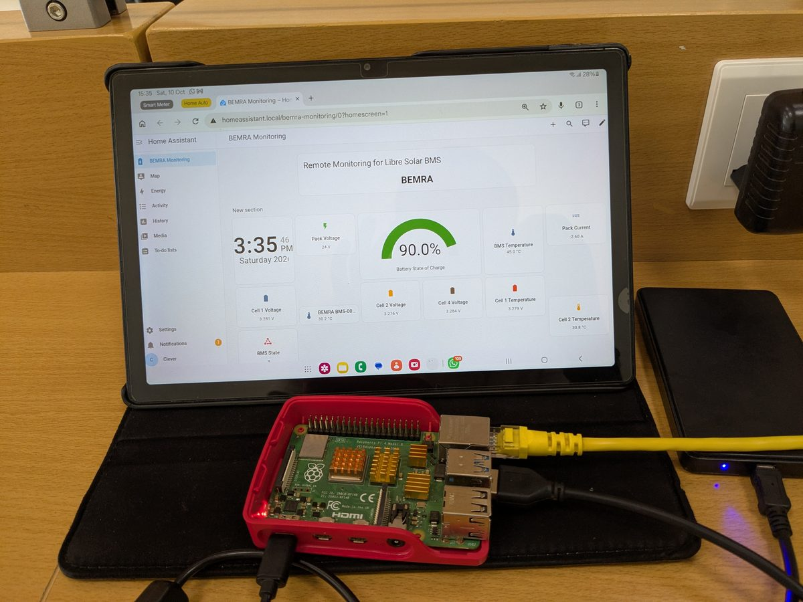
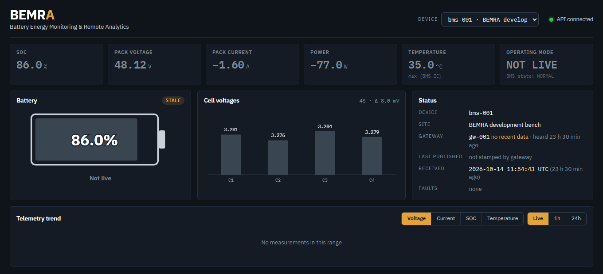

<p align="center">
  
</p>

<p align="center">
  <b>Open remote monitoring for the Libre Solar BMS</b><br>
  OSEAS 2026 Hackathon · Challenge: <i>Open Remote Monitoring Gateway for Libre Solar BMS</i> · Kigali, Rwanda
</p>

<p align="center">
  
  
  
  
</p>

---

## In one minute

A Libre Solar BMS in the field is a black box. It knows the state of charge, every cell
voltage and every fault, but nobody can see any of that without driving to the site.

**BEMRA** (Battery Energy Monitoring & Remote Analytics) gets that data out over **2G cellular**,
so a site needs no Wi-Fi or wired internet. A low-cost ESP32 + SIM800L
board reads the BMS's own ThingSet reports over UART, wraps them in a small, versioned JSON
envelope and publishes them over MQTT. From there, three kinds of consumers pick them up:

- **Home Assistant** discovers the battery automatically (no YAML entity setup).
- **A Node.js backend** validates every message, stores it once in PostgreSQL even if it
  arrives twice, and serves a read-only REST API.
- **A web dashboard** shows a live view of each pack, and tells you honestly when the data is stale.

The pieces share one contract, [`MQTT contract v1`](BEMRA/software/backend/docs/mqtt-contract.md),
backed by [JSON Schemas](BEMRA/software/backend/src/contracts/schemas/). Each piece either produces
or subscribes to that contract.

> [!NOTE]
> **Where we honestly are (15 Oct 2026, mid-point review).** The simulator, gateway firmware,
> MQTT contract, backend, Home Assistant discovery and dashboard are built and tested. The
> gateway has connected to the broker over the Airtel 2G network, but we have **not yet
> tested against a physical BMS C1**. The **MicroPowerManager** integration is only a provisional
> API endpoint, and **Prospect** is not integrated yet. The [status table](#what-is-built-and-what-is-not)
> lists exactly what is done and what is not.

---

## Contents

1. [The problem](#the-problem) and [who it is for](#who-it-is-for)
2. [What is built and what is not](#what-is-built-and-what-is-not)
   and [the challenge's expected outcomes](#against-the-challenges-expected-outcomes)
3. [System architecture](#system-architecture)
4. [End-to-end data flow](#end-to-end-data-flow)
5. [Hardware](#hardware)
6. [BMS simulator (ThingSet over UART)](#bms-simulator-thingset-over-uart)
7. [ESP32 cellular gateway firmware](#esp32-cellular-gateway-firmware)
8. [MQTT contract: topics and payloads](#mqtt-contract-topics-and-payloads)
9. [Reliability: QoS 1, keep-alive and idempotent storage](#reliability-qos-1-keep-alive-and-idempotent-storage)
10. [Backend and REST API](#backend-and-rest-api)
11. [Home Assistant auto-discovery](#home-assistant-auto-discovery)
12. [Web dashboard](#web-dashboard)
13. [MicroPowerManager and Prospect](#micropowermanager-and-prospect)
14. [Testing and results](#testing-and-results)
15. [Engineering decisions and trade-offs](#engineering-decisions-and-trade-offs)
16. [Security](#security)
17. [Known limitations](#known-limitations)
18. [Reproduce it](#reproduce-it)
19. [Continue development](#continue-development)
20. [Contributing and AI-use disclosure](#contributing-and-ai-use-disclosure)
21. [Repository layout](#repository-layout)
22. [Roadmap](#roadmap)

---

## The problem

Off-grid solar operators in Sub-Saharan Africa lose batteries to problems that are cheap to fix
early and expensive to fix late: a drifting cell, a pack that runs hot every afternoon, a system
that is simply undersized for its load. The [Libre Solar BMS C1](https://github.com/LibreSolar/bms-c1)
already measures all of this. What is missing is an **open, affordable way to get that data off
the site** and into the tools operators already use, without a proprietary logger or a cloud
subscription.

Three constraints shaped everything we built:

| Constraint | What it means for the design |
|---|---|
| **Connectivity is thin.** Many sites have only 2G, and data costs money. | Small payloads, a slow publish rate, and no gateway-side extras (summaries, discovery) that the server can do instead. |
| **The consumers are different in kind.** Home Assistant and Prospect want time series; MicroPowerManager is a CRM/ERP and wants a few decision-relevant numbers. | One clean MQTT feed. Each platform subscribes and shapes it for itself; nobody talks to the gateway directly. |
| **The data must stay trustworthy.** Field networks drop, retry and reorder. | Every message carries identity and a sequence number; storage is idempotent; stale data is labelled as stale. |

### Who it is for

The challenge names the target users: **SLS Energy and other teams running Libre Solar BMS
deployments**. In practice, that means three people:

| User | Question they need answered | Where BEMRA answers it |
|---|---|---|
| **Field technician** | "Is this pack healthy, and is it worth a trip?" | Dashboard: SOC, per-cell voltages and spread, temperature, active faults, and whether the data is current |
| **Operations / asset manager** | "Which batteries are degrading or undersized across my sites?" | REST history and aggregates; the (provisional) MPM summary of SOC range, cell imbalance, max temperature and fault counts |
| **Site owner or community operator** | "What is my battery doing right now?" | Home Assistant on a local device, configured automatically |

What changes for them: a drifting cell (rising spread in mV), a pack that runs hot, or a pack that
sits at low SOC every evening becomes visible **from a distance and before it fails**, instead of being
found at the next site visit. We have not measured that impact in the field yet. BEMRA has run on a
bench, not at a customer site.

---

## What is built and what is not

| Component | Status | Evidence |
|---|---|---|
| ThingSet BMS simulator (Python, serial) | Built | [`thingset_bms_sim.py`](BEMRA/edge-gateway-esp32-lilygo/simulator/thingset_bms_sim.py), bench runs with the ESP32 |
| ESP32 + SIM800L gateway firmware | Built, compiles (332,624 B flash, 25 %) | [`bemra_gateway.ino`](BEMRA/edge-gateway-esp32-lilygo/firmware/bemra_gateway/bemra_gateway.ino) |
| Gateway → broker over Airtel 2G (GPRS) | Connection verified | Broker published the firmware's Last Will for boot `0c777ce8`; stored by the backend on 10 Oct 2026 ([details](docs/testing.md#5-cellular-transport)) |
| Gateway telemetry stored end-to-end from GPRS | Not yet captured | No telemetry row from a firmware boot ID is in the database yet ([why](docs/testing.md#5-cellular-transport)) |
| MQTT contract v1 + JSON Schemas | Built | [`mqtt-contract.md`](BEMRA/software/backend/docs/mqtt-contract.md), 18 contract tests |
| Ingestion worker → PostgreSQL | Built, tested | 9-step live end-to-end run, 59 automated tests |
| REST API (read-only) + OpenAPI 3.1 | Built, tested; also deployed by the team on Render | [`openapi.yaml`](BEMRA/software/backend/docs/openapi.yaml), [Postman capture](#rest-api) |
| Home Assistant MQTT auto-discovery | Built, used on a Raspberry Pi running Home Assistant OS | [`ha-discovery.js`](BEMRA/software/backend/src/integrations/ha-discovery.js), [photo](#home-assistant-auto-discovery) |
| Web dashboard (React) | Built, tested | 17 tests, [screenshot](#web-dashboard) |
| **MicroPowerManager** integration | Provisional backend endpoint only | `/integrations/mpm/devices/{id}/summary` exists; **nothing has been written into MPM** and no MPM UI exists |
| **Prospect (A2EI)** integration | Not started | The MQTT feed is ready for another subscriber; no adapter yet |
| Physical Libre Solar BMS C1 on the UART | Not yet tested | All gateway runs so far used the simulator |
| Offline buffering + `replay` on the gateway | Not in firmware | Supported by the contract and backend, not by the ESP32 code yet |
| Continuous integration | Workflow added | [`.github/workflows/ci.yml`](.github/workflows/ci.yml): lint, format, tests (with a PostgreSQL service) and build for backend and frontend, plus a simulator smoke test. Every step was run locally; the workflow itself runs once it is pushed to GitHub. |

### Against the challenge's expected outcomes

Each row quotes an expected outcome from the [challenge brief](https://github.com/EnAccess/oseas26-libre-solar-bms-monitoring-gateway#expected-outcomes).

| Expected outcome | Where we are |
|---|---|
| **BMS simulator** that publishes representative BMS JSON to MQTT against the agreed schema | Done. Two layers: [`thingset_bms_sim.py`](BEMRA/edge-gateway-esp32-lilygo/simulator/thingset_bms_sim.py) simulates the BMS *serial port*, so the real gateway is exercised, and `npm run mqtt:publish-sample` publishes schema-valid JSON straight to MQTT |
| **Documented MQTT schema**, including Home Assistant auto-discovery | Done: [Contract](BEMRA/software/backend/docs/mqtt-contract.md), JSON Schemas, [ThingSet mapping](BEMRA/software/backend/docs/thingset-mapping.md), discovery described [below](#home-assistant-auto-discovery) |
| **MPM integration:** ingestion into MPM and a battery-health view in the asset UI | Partial: backend summary endpoint only; **no ingestion into MPM and no MPM UI** |
| **Home Assistant integration** via auto-discovery | Done |
| **One real transport path proven end-to-end** (A1 Wi-Fi, or A2 UART → cellular) against the shared real BMS, with the simulator as fallback | Partial: A2-style path built (UART → ESP32 + SIM800L → 2G → broker). It is proven up to the broker MQTT session, using the simulator; not yet against the real BMS, and not yet as a stored telemetry row ([details](docs/testing.md#5-cellular-transport)) |
| **Documentation:** setup and reproduction steps for a field-deployable kit | Done for the software and bench kit (this README, [test record](docs/testing.md), [e2e procedure](BEMRA/software/backend/docs/testing-e2e.md)). Field deployment (enclosure, power, antenna, private broker) is not documented yet. |

---

## System architecture



Three principles shape the design:

1. **The gateway is a faithful courier, not an interpreter.** It forwards the BMS's own ThingSet
   object names and units (`rPackVoltage_V`, `rCellVoltages_V`, …) unchanged and adds only
   identity, a sequence number and timestamps. Nobody downstream has to guess what a field means;
   the [Libre Solar firmware](https://github.com/LibreSolar/bms-firmware) is the dictionary.
2. **The broker is the hub.** Home Assistant reads the same topic the backend reads. Adding Prospect
   or anything else means adding a subscriber, not touching the gateway.
3. **Work moves to where it is cheap.** Summaries, Home Assistant discovery and staleness checks run
   on the server, not on a 2G link.

---

## End-to-end data flow

This is one telemetry cycle, as implemented in the firmware and the worker:



Two details matter here:
- **The worker sends PUBACK only after the database commit.** If PostgreSQL is down, the message
  is not acknowledged and the broker sends it again later.
- **The gateway never discards an unacknowledged message.** It keeps it in RAM and re-sends it after
  reconnecting. Duplicates are expected and harmless (see [reliability](#reliability-qos-1-keep-alive-and-idempotent-storage)).

---

## Hardware

<table>
<tr>
<td width="50%"><br><sub>Libre Solar BMS C1 (photo: Libre Solar, open hardware).</sub></td>
<td width="50%"><br><sub>Our LILYGO T-Call gateway on the bench (module label blurred: it carries the IMEI).</sub></td>
</tr>
</table>

| Part | Role | Notes |
|---|---|---|
| **Libre Solar BMS C1** | Battery management, measurement source | ESP32-C3 running Zephyr; prints ThingSet live reports on its serial port. *Not yet connected to our gateway; the simulator stands in.* |
| **LILYGO T-Call ESP32 + SIM800L** | Edge gateway | ESP32 (dual core, 240 MHz) + SIM800L quad-band 2G modem on one board, with an IP5306 power-management IC |
| **Airtel Rwanda SIM** | Cellular backhaul | APN `internet` (configurable in [`config.h`](BEMRA/edge-gateway-esp32-lilygo/firmware/bemra_gateway/config.h)) |
| **Raspberry Pi + Home Assistant OS 18.3** | Local monitoring station | Runs Home Assistant, subscribed to the broker |
| **Battery (bench)** | 4S LiFePO4 profile | Simulated: 4 cells, 6 Ah, 2 thermistors (the simulator's defaults) |

**T-Call pin map used by the firmware**

| Signal | ESP32 GPIO | Purpose |
|---|---|---|
| `MODEM_PWKEY` | 4 | SIM800L power key (held low) |
| `MODEM_RST` | 5 | SIM800L reset (held high) |
| `MODEM_POWER_ON` | 23 | Modem supply enable |
| `MODEM_TX` / `MODEM_RX` | 27 / 26 | `SerialAT` (UART1) to the modem, 115200 baud |
| I²C SDA / SCL | 21 / 22 | IP5306 power IC at `0x75`: register write keeps the boost converter on even at light load, so the modem supply isn't cut |
| USB serial (UART0) | 1 / 3 | ThingSet input from the BMS/simulator **and** gateway logs (see [limitations](#known-limitations)) |

---

## BMS simulator (ThingSet over UART)

The challenge asks for a simulator first, so software work isn't blocked on hardware. We went a
step further: [`thingset_bms_sim.py`](BEMRA/edge-gateway-esp32-lilygo/simulator/thingset_bms_sim.py) simulates
the **BMS's serial port**, not the MQTT feed. That way the real gateway firmware is exercised
byte-for-byte as it would be on a real BMS.

It emits exactly what the Libre Solar firmware prints in ThingSet text mode:

```text
#mLive {"Meas":{"rPackVoltage_V":12.98,"rPackCurrent_A":-2.0,"rSOC_pct":69.1,"rCellVoltages_V":[3.241,3.245,3.25,3.242],"rCellTemps_degC":[25.0,25.3],"rICTemp_degC":28.0,"rErrorFlags":0,"rBmsState":3}}
```

**What makes it more than a random-number generator**

- **A physical LiFePO4 model.** It uses the firmware's own OCV-vs-SOC table, coulomb counting,
  per-cell capacity spread (±2 %) and internal resistance (15–25 mΩ), so cells drift apart naturally
  and the voltage sags under load. It also models I²R heating.
- **Firmware semantics.** `rBmsState` is the firmware's `uint8` enum (0 OFF … 4 SHUTDOWN),
  `rErrorFlags` uses the real `BMS_ERR_*` bit positions, and current is positive while charging.
- **Protection behaviour.** Over/under-voltage and over-temperature trip like the firmware defaults,
  and the FETs open in the right direction.
- **Two-way protocol.** It answers the ThingSet requests `?Device` and `?Conf` with `:85 {…}`.
  The CRC suffix can be switched on with `--crc`.
- **Scenarios and faults.** `--scenario cycle|charge|discharge|idle`, `--fault undervoltage|overvoltage|overtemp`,
  `--speed 60` for time-lapse runs, and `--dry-run` for use without hardware.

```powershell
pip install -r requirements.txt
py thingset_bms_sim.py --port COM3              # stream to the ESP32 every 120 s
py thingset_bms_sim.py --dry-run --interval 2    # watch the reports, no hardware
```

Gateway log lines (prefixed `[gw]`) come back over the same USB cable, so one terminal shows both
sides of the link.

> For pure software testing without any serial hardware, the backend also ships
> `npm run mqtt:publish-sample`, which publishes contract-valid JSON straight to MQTT.

---

## ESP32 cellular gateway firmware

[`bemra_gateway.ino`](BEMRA/edge-gateway-esp32-lilygo/firmware/bemra_gateway/bemra_gateway.ino) is about 270 lines.
It is **non-blocking by design**: there is no `delay()` anywhere. `loop()` does four short things
on every pass:

```c
void loop() {
  readSerial();                       // 1. take in BMS data (only bytes already received)
  runConnection();                    // 2. advance the connection state machine
  if (state == ONLINE) mqtt.loop();   // 3. keep-alive handling
  runTelemetry();                     // 4. publish on schedule
}
```

The connection logic is an explicit, timer-driven state machine with an overflow-safe `millis()` check:



**What the firmware does**

| Behaviour | How |
|---|---|
| Reads ThingSet reports | Line-based parser on UART0; accepts only `#mLive ` lines; bounded line buffer (2,000 chars); 4 KiB RX buffer to absorb reports while a library call is busy |
| Validates input | Rejects reports that aren't JSON or lack `rPackVoltage_V`, `rSOC_pct` or `rCellVoltages_V` |
| Trims arrays | The firmware's fixed-size arrays (16 cells, 3 thermistors) are cut to the connected count (`CELL_COUNT 4`, `THERMISTOR_COUNT 2`) |
| Identity | `boot_id` = 8 random hex chars from the ESP32 hardware RNG at every boot; `sequence` increments per message |
| Publishes | Every 120 s (the first one as soon as data and link exist), QoS 1, never re-sends an old reading |
| Never loses an unacknowledged message | The built message stays in `unsent` until PUBACK; reconnect and re-send on failure |
| Presence | Last Will = retained `offline` status; a retained `online` status on every connect |
| Recovers stuck sockets | After 3 MQTT connect failures (`err -3`) it tears down and re-attaches GPRS |

The libraries we used are TinyGSM 0.12, MQTT 2.5.3 (Joel Gaehwiler), ArduinoJson 7.4.3 and ESP32 Arduino core 3.3.12.
Library calls such as the GPRS attach and the MQTT connect still block, but only up to their own
bounded timeouts (`MQTT_TIMEOUT_MS = 15000`).

---

## MQTT contract: topics and payloads

The full specification is in [`mqtt-contract.md`](BEMRA/software/backend/docs/mqtt-contract.md). The
machine-readable source of truth is the JSON Schemas (draft 2020-12) in
[`src/contracts/schemas/`](BEMRA/software/backend/src/contracts/schemas/), and the backend validates
every message against them.

### Topic hierarchy

```text
{root}/v1/{site_id}/{device_id}/live               telemetry snapshot          QoS 1
{root}/v1/{site_id}/{device_id}/replay             snapshots buffered offline  QoS 1
{root}/v1/{site_id}/{device_id}/meta               device info + pack layout   QoS 1, retained
{root}/v1/{site_id}/{device_id}/event              fault raised / cleared      QoS 1
{root}/v1/{site_id}/gateways/{gateway_id}/status   online / offline (LWT)      QoS 1, retained
```

On the shared public broker `{root}` is `bemra-dev-01092a`, a private namespace to avoid collisions.
(A namespace is not security; see [Security](#security).) The version lives **in the topic** (`/v1/`),
so a future breaking `v2` can run side by side with `v1` during a migration.

| Topic kind | Built by our firmware today? | Accepted and stored by the backend? |
|---|---|---|
| `live` | Yes | Yes |
| `status` + Last Will | Yes | Yes |
| `meta`, `event`, `replay` | No (roadmap) | Yes (tested with sample payloads) |

### The live payload (exactly what the gateway sends: 401 bytes)

```json
{
  "schema_version": "1.0",
  "device_id": "bms-001",
  "gateway_id": "gw-001",
  "site_id": "site-001",
  "boot_id": "0c777ce8",
  "sequence": 1,
  "timestamps": { "measured_at": null, "gateway_received_at": null, "published_at": null },
  "thingset": {
    "rPackVoltage_V": 12.98,
    "rPackCurrent_A": -2.0,
    "rSOC_pct": 69.1,
    "rCellVoltages_V": [3.241, 3.245, 3.25, 3.242],
    "rCellTemps_degC": [25.0, 25.3],
    "rICTemp_degC": 28.0,
    "rErrorFlags": 0,
    "rBmsState": 3
  }
}
```

| Field | Rule | Why |
|---|---|---|
| `device_id`, `site_id` | Must match the topic segments | A message can't claim to be from somewhere else |
| `boot_id` + `sequence` | Together with `device_id`, a unique message key | Lets the backend drop retransmissions without trusting clocks |
| `timestamps.*` | RFC 3339 or `null`, never invented | The ThingSet live report has no timestamp and our gateway has no synced clock yet, so these are honestly `null`; the backend then stamps reception time and says so (`observed_at_source: "backend"`) |
| `thingset` | Original Libre Solar names and units | Required: `rPackVoltage_V`, `rSOC_pct`, `rErrorFlags`, `rBmsState`, `rCellVoltages_V`. Extra read-only `r…` objects are accepted for forward compatibility; writable `s…/w…/x…` objects are rejected |
| Bounds | Cell > 10 V, SOC outside 0–100, etc. are rejected | These are corruption guards, not alarm limits |

<details>
<summary><b>Status (Last Will) payload</b> stored from our gateway on 10 Oct 2026</summary>

```json
{ "schema_version": "1.0", "gateway_id": "gw-001", "site_id": "site-001", "state": "offline", "boot_id": "0c777ce8" }
```
</details>

### Bandwidth budget (estimate)

At one message every 120 s, that is 720 messages a day. 720 × ~0.4 kB of payload plus MQTT/TCP
headers, PUBACKs and the 45 s keep-alive pings comes to **roughly 15 MB per month per gateway**.
This is an estimate from message sizes, not a measurement from the operator's bill. The same data
at the Wi-Fi rate of 5 s would cost about 24 times more, which is why the rate is a deliberate
configuration value.

---

## Reliability: QoS 1, keep-alive and idempotent storage

The system is designed to be **at-least-once with idempotent storage**. It is honestly *not*
exactly-once.



| Mechanism | What it protects against | Verified? |
|---|---|---|
| QoS 1 gateway → broker, message held in RAM until PUBACK | A lost publish on a flaky GPRS link | Implemented; failure path seen on the bench ("no PUBACK" → reconnect → re-send) |
| PUBACK only after the PostgreSQL commit | Losing data when the database is down | Yes. DB outage test: no PUBACK sent, broker redelivered, row stored |
| Unique key `(device_id, boot_id, sequence)` | Duplicates from redelivery | Yes. The same message published twice → one row |
| `sequence_conflict` | A gateway bug that reuses a sequence for different data | Yes: 10 real conflicts caught during manual MQTTX testing |
| Random `boot_id` per boot | Sequence restarting at 1 after a reboot | Yes: Different boot = different key space |
| Retained Last Will | A gateway that silently disappears | Yes. The broker published our gateway's `offline` status |
| Keep-alive tuned to the network | Idle connections being cut by the path | Yes: measured, see below |

### Failure cases and what the system does

| Failure | Behaviour | Data lost? |
|---|---|---|
| BMS sends a malformed or incomplete line | Gateway logs it and ignores it; the last good reading is kept | No |
| BMS stops reporting | Gateway publishes nothing new (it never re-sends an old reading). Dashboard shows *not live* after 150 s; API flags *stale* and HA entities expire after 300 s | Nothing to lose |
| No network registration | Polls for 2 min, then re-initialises the modem | Readings arriving meanwhile replace each other |
| GPRS attach fails | Back to network wait, retry after 10 s | Same |
| MQTT connect keeps failing (`err -3`, stuck socket) | After 3 failures: tear down and re-attach GPRS | Same |
| Publish gets no PUBACK | Message kept, reconnect, re-send; the backend drops the duplicate if the first one did arrive | No |
| Gateway loses power or reboots | Broker publishes the retained Last Will (`offline`); new `boot_id`, so sequences can't collide | The one unsent message in RAM |
| Long outage | Only the newest reading survives (no flash buffer yet) | **Yes**: intermediate readings |
| Backend worker down | Public broker: messages published meanwhile are lost. Private broker: queued for the persistent session | Public broker: **yes** |
| Database down | No PUBACK; retries with back-off, then disconnects; broker redelivers once the DB is back | No |
| Bad, oversized, unregistered or mis-routed message | Rejected with a reason in `ingest_rejections`, acknowledged so it can't block the queue | Rejected by design |
| Same message twice | Ignored (unique key) | No |
| REST API unreachable | Dashboard shows "Backend unreachable" instead of old numbers | No |

### Keep-alive: measured, not guessed

Our worker kept dropping its connection every 60–120 s. To find out why, we ran three plain clients
for five minutes. With a 60 s keep-alive the connection was closed by the remote side at 60.8 s
and 123.5 s; with 30 s it never dropped. Something on the path to `test.mosquitto.org` closes
connections that are idle for about 60 s, and a ping scheduled *at* 60 s loses that race.

| Hop | Keep-alive | Reason |
|---|---|---|
| Backend worker | **30 s** | Well below the measured ~60 s idle cut-off |
| ESP32 on GPRS | **45 s** | With the first 120 s keep-alive, publishes after a 2-minute idle gap got no PUBACK; 45 s keeps the link warm for roughly 6 MB/month of pings (estimate) |

### A public-broker limitation we found in testing

On `test.mosquitto.org`, a **persistent session** (`clean=false`) was resumed
(`sessionPresent=true`), but it did not deliver messages queued while the subscriber was offline.
On 10 Oct, the persistent session stopped receiving anything at all: it got a SUBACK but no messages,
while a clean session with the same filters received all three test messages. The fix is a
configuration switch (`MQTT_CLEAN_SESSION=true` on public test brokers). It also means that **on the
public broker, anything published while the backend is down is lost**. A private Mosquitto with
`max_queued_messages` is needed to get the full guarantee.

---

## Backend and REST API

[`BEMRA/software/backend`](BEMRA/software/backend) is Node.js (ESM, ≥ 22.12) with Express 5, `mqtt`, `pg`,
Ajv and Pino. It runs as two processes that can be started on their own:

| Process | Job |
|---|---|
| **Ingestion worker** ([`worker.js`](BEMRA/software/backend/src/mqtt/worker.js)) | Subscribes to the contract topics, validates, deduplicates, stores. It processes one message at a time, so memory stays bounded and the broker applies back-pressure. It also publishes Home Assistant discovery every 5 min. |
| **REST API** ([`app.js`](BEMRA/software/backend/src/app.js)) | Read-only HTTP API, API-key auth, OpenAPI 3.1 |

**Validation pipeline:** payload size (≤ 16 KiB) → JSON → schema → topic/payload identity → device
registered and active → site and gateway match the assignment **valid at the time of the message**
(so data buffered before a relocation is still accepted under the old site) → dedup.

Rejected messages are acknowledged, so they can't block the queue, and recorded in
`ingest_rejections` with a reason. There are 13 reasons, including `schema_violation`, `unknown_device`,
`gateway_mismatch` and `sequence_conflict`.

**Storage** ([`0001_initial_schema.sql`](BEMRA/software/backend/migrations/0001_initial_schema.sql)): 11 tables
and one view. Telemetry keeps the **complete ThingSet object as JSONB** (nothing is thrown away) plus
typed columns for the fields that get queried, and one row per cell in `cell_measurements`.
Sites, gateways and devices are linked by time-bounded assignments, so a battery can move between
sites without rewriting its history.

### REST API

All data endpoints live under `/api/v1` and require an `X-API-Key` header. The key is mandatory when
`NODE_ENV=production` and optional in development. The full spec is in
[`openapi.yaml`](BEMRA/software/backend/docs/openapi.yaml) (also served at `/api/v1/openapi.json`), and there is
a ready-made [Postman collection](BEMRA/software/backend/docs/postman/bemra.postman_collection.json).

| Method + path | Returns |
|---|---|
| `GET /health` · `GET /ready` | Process alive · database reachable and migrations applied (no key needed) |
| `GET /api/v1/sites` | Sites |
| `GET /api/v1/devices` | Devices with their current site and gateway (`?site=` filter) |
| `GET /api/v1/devices/{id}` | One device's registry and metadata |
| `GET /api/v1/devices/{id}/status` | Gateway online/offline, data freshness, BMS state, active faults |
| `GET /api/v1/devices/{id}/latest` | Newest measurement, with units, decoded state and errors, and time quality |
| `GET /api/v1/devices/{id}/thingset` | The latest raw ThingSet object, exactly as received |
| `GET /api/v1/devices/{id}/cells` | Latest per-cell voltages and temperatures |
| `GET /api/v1/devices/{id}/telemetry` | History: raw with cursor pagination, or aggregated (`interval=1m…1d`, min/avg/max) |
| `GET /api/v1/devices/{id}/events` | Faults and state changes (`?severity=`) |
| `GET /api/v1/integrations/home-assistant/devices/{id}` | Flat key/value view (for HA's REST sensor, as an alternative to MQTT) |
| `GET /api/v1/integrations/mpm/devices/{id}/summary` | **Provisional** 15 min / hourly / daily summary for an MPM adapter |

History parameters: `from` and `to` (RFC 3339; the default window is the last 24 h, the maximum 366 days),
`interval` (`raw`, `1m`, `5m`, `15m`, `1h`, `6h`, `1d`), `fields`, `limit` (1–5000), `order`, `cursor`.

<details open>
<summary><b>Example: <code>GET /api/v1/devices/bms-001/latest</code></b> (a real response from our bench, trimmed)</summary>

```json
{
  "data": {
    "device_id": "bms-001",
    "measurements": {
      "rSOC_pct":        { "value": 86,    "unit": "%",  "thingset_id": "0x7c" },
      "rPackCurrent_A":  { "value": -1.6,  "unit": "A",  "thingset_id": "0x73" },
      "rCellVoltages_V": { "value": [3.281, 3.276, 3.284, 3.279], "unit": "V", "thingset_id": "0x80" }
    },
    "not_reported": ["rStackVoltage_V", "rMOSFETTemp_degC", "rShuntTemp_degC", "rBalancingStatus"],
    "bms_state":   { "value": 3, "code": "NORMAL", "description": "Normal (charging and discharging enabled)" },
    "error_flags": { "value": 0, "active": [], "unknown_bits": [] },
    "timestamps": {
      "measured_at": null, "gateway_received_at": null, "published_at": null,
      "ingested_at": "2026-10-14T11:54:43.351Z",
      "observed_at": "2026-10-14T11:54:43.351Z",
      "observed_at_source": "backend",
      "time_flags": ["no_gateway_clock"]
    },
    "source": { "gateway_id": "gw-001", "site_id": "site-001", "boot_id": "mqttx0002", "sequence": 8, "delivery": "live" },
    "data_freshness": { "age_s": 84538, "stale": true, "stale_after_s": 300 }
  }
}
```
The response states what it doesn't know: which objects the BMS didn't report (`not_reported`),
that the time came from the backend rather than the gateway, and that the data is stale.
</details>

<details>
<summary><b>Example: aggregated history</b> <code>GET …/telemetry?from=2026-10-10T00:00:00Z&to=2026-10-11T00:00:00Z&interval=1h&fields=rSOC_pct</code></summary>

```json
{
  "data": [
    { "bucket_start": "2026-10-10T13:00:00.000Z", "sample_count": 2,
      "values": { "rSOC_pct": { "min": 15, "avg": 52.5, "max": 90 } } }
  ],
  "meta": { "interval": "1h", "bucket_seconds": 3600, "units": { "rSOC_pct": "%" }, "empty_buckets": "omitted" }
}
```
</details>

<details>
<summary><b>Example: errors</b></summary>

```http
GET /api/v1/devices/bms-404/latest            → 404 {"error":{"code":"not_found","message":"Device bms-404 is not registered"}}
GET /api/v1/devices  (no key, production)      → 401 {"error":{"code":"unauthorized","message":"Missing X-API-Key header"}}
```
</details>

The team also deployed the backend on Render. Here it is answering through Postman with an API key
(key blurred). The 22 s response time is most likely a free-tier instance waking up from sleep:

<p align="center"></p>

---

## Home Assistant auto-discovery

Nothing has to be configured entity by entity. The **backend** (not the gateway) publishes retained
[MQTT discovery](https://www.home-assistant.io/integrations/mqtt/#mqtt-discovery) configs for every
registered, active device ([`ha-discovery.js`](BEMRA/software/backend/src/integrations/ha-discovery.js)).
Each entity reads the gateway's existing `live` topic through a value template, so **the firmware sends
nothing extra over 2G for Home Assistant**.

| Entities per device | Source |
|---|---|
| SOC, pack voltage, pack current, power (V × I), BMS IC temperature | `thingset.*` |
| Cell spread in mV (max − min) | computed in the template |
| `Cell 1…n` voltage, `Thermistor 1…n` temperature | one entity per connected cell/thermistor, from the registry's pack layout |
| BMS state (`Off / Charge only / Discharge only / Normal / Shutdown`), operating mode (`Charging / Discharging / Idle`), error flags | decoded in the template |
| `Fault` binary sensor (`device_class: problem`) | `rErrorFlags > 0` |

- **Availability** follows the gateway's retained `status` topic. When the broker fires the Last Will,
  every entity turns *unavailable*.
- **Staleness:** `expire_after: 300` marks an entity unavailable if no telemetry arrives for 5 min
  (2.5 publish intervals).
- **Shared-broker safety:** the discovery prefix is `bemra-dev-01092a/homeassistant`, not the global
  `homeassistant`, so other people on `test.mosquitto.org` don't get our entities and we don't get theirs.

A ready-to-paste dashboard using built-in cards only is in
[`bemra-dashboard.yaml`](BEMRA/software/backend/docs/home-assistant/bemra-dashboard.yaml).

<p align="center"><br>
<sub>Home Assistant OS on a Raspberry Pi, showing the BEMRA dashboard on a tablet (10 Oct 2026, 15:35).
The values on screen come from a test payload published by hand with MQTTX, stored by the backend
at 15:29 as <code>mqttx0002</code> #7. They are not readings from the gateway.</sub></p>

---

## Web dashboard

[`BEMRA/software/frontend`](BEMRA/software/frontend) is React 19 + TypeScript + Vite, using TanStack Query
and ECharts. It is a single page on purpose: one battery at a time, the numbers an operator needs,
nothing decorative.

<p align="center"><br>
<sub>A real capture from our bench (15 Oct 2026). The data is a day old, so the dashboard greys out the
values and marks them <b>STALE / NOT LIVE</b> instead of presenting them as current.</sub></p>

- **KPIs:** SOC, pack voltage, current, power, maximum temperature, and operating mode.
- **Battery graphic** coloured by SOC, and per-cell voltage bars with the spread (Δ mV).
- **Status panel** with device, site, gateway link, last published and last received times, and faults.
- **Trend chart** for voltage, current, SOC and temperature over live, 1 h or 24 h.
- **Device picker** for every registered device.
- **Honest freshness:** data counts as *live* only while it is younger than 150 s (one 120 s publish
  interval plus margin). The gateway shows as *online*, *offline* (a Last Will newer than the data)
  or *silent*.
- **Polling:** every 5 s it fetches only new rows.

---

## MicroPowerManager and Prospect

We want to be precise here, because these were explicit challenge goals.

| Platform | Intended role | What exists today | What does not |
|---|---|---|---|
| **MicroPowerManager** | Low-frequency, decision-relevant battery state as asset data and events, not a time series | A provisional endpoint, `GET /api/v1/integrations/mpm/devices/{id}/summary`, with 15 min / hourly / daily buckets: SOC last/min/max, voltage and current ranges, max cell spread, max temperature, OR-ed error flags and event counts. It is covered by an integration test and labelled `"compatibility": "provisional"` in every response. | Any code running inside MPM; writing data into MPM; the battery-health view in MPM's asset UI. The shape has **not** been checked against MPM's real integration API. |
| **Prospect (A2EI)** | Full time-series consumer of the same feed | Nothing specific. The MQTT contract and the REST history API are what an adapter would consume. | Any Prospect adapter or configuration. |

---

## Testing and results

The full record, with methods and raw observations, is in **[docs/testing.md](docs/testing.md)**.
Here is the summary:

| # | What was tested | How | Result |
|---|---|---|---|
| 1 | Contract, topics, decoding, config, query validation | `npm test` (unit) | Passed (part of 59/59) |
| 2 | MQTT → PostgreSQL ingestion and REST API | `npm test` (integration, real PostgreSQL) | Passed (part of 59/59, 15 Oct 2026) |
| 3 | Live chain: publish → public broker (TLS) → worker → DB → API | 9 scripted messages: valid, duplicate, replay, event, 3 kinds of invalid | Passed: 9/9 as expected (9 Oct) |
| 4 | Database outage during ingestion | Removed the DB connection mid-run | Passed: No PUBACK; broker redelivered; stored after recovery |
| 5 | Worker killed (`kill -9`) on a local broker | 2 messages published while it was down | Passed: Both stored after restart |
| 6 | Keep-alive | 3 clients × 5 min at 60 s and 30 s | Passed: 60 s dropped at 60.8 s / 123.5 s; 30 s stable |
| 7 | Simulator → ESP32 over UART | Bench, COM3, gateway log on the same console | Observed: reports parsed and turned into messages (console logs not archived) |
| 8 | ESP32 → broker over Airtel 2G | Bench | Partial: MQTT session established (Last Will for boot `0c777ce8` stored); a stored telemetry row from the GPRS path is **not yet captured** |
| 9 | Home Assistant discovery | Unit tests + HA OS 18.3 on a Raspberry Pi | Passed: Entities created and updating from the shared feed (test payloads) |
| 10 | Web dashboard | `vitest` (17 tests incl. API integration with mocks) + manual | Passed: 17/17; stale handling seen on a real capture |
| 11 | Hosted API | Postman against the Render deployment | Passed: `200 OK` for `/api/v1/openapi.json` |
| 12 | Physical BMS C1 | n/a | Not yet done |

Messages are rejected loudly, not silently. While we were testing by hand, the database collected
18 rejected messages with 6 different reasons: 10 × `sequence_conflict` (we reused sequence
numbers in MQTTX), 3 × `schema_violation`, 2 × `gateway_mismatch` (bms-001 sent through the wrong
gateway), and one each of `unknown_device`, `identity_mismatch` and `invalid_json`. None of them
reached the telemetry table.

---

## Engineering decisions and trade-offs

| Decision | Why we made it | What it costs us |
|---|---|---|
| **Transport path A2 (UART → external cellular gateway) rather than A1 (BMS publishes over Wi-Fi)** | Many sites have no Wi-Fi to join. A2 also needs **no change to the BMS firmware**: the gateway reads the ThingSet output the BMS already prints, so any BMS running stock Libre Solar firmware can be monitored. | A second board per site (cost, power, enclosure). A1 would be cheaper wherever Wi-Fi exists; the MQTT contract is the same for both, so A1 can be added without touching the backend. |
| **LILYGO T-Call (ESP32 + SIM800L, 2G) instead of the Cicada 4G module** | We had the board, it is cheap and well supported in the Arduino ecosystem, and it registered and attached on Airtel Rwanda's network in our tests | 2G networks are being switched off in many countries, and the SIM800L's built-in TLS is limited (old protocol versions). The firmware talks to the modem through TinyGSM, so a SIM7600-class modem means changing the modem `#define` plus adding TLS. |
| **Plain MQTT on 1883 from the gateway** | We did not get dependable TLS from the SIM800L, and the demo broker accepts plain connections | Telemetry is readable and spoofable in transit. Acceptable for a public-broker demo, not for deployment (see [Security](#security)). |
| **Keep the ThingSet names unchanged** | No translation layer to drift out of sync with the firmware; the firmware source is the documentation | Names like `rPackVoltage_V` are less friendly than `pack_voltage`; the UI and HA templates provide friendly labels. |
| **Gateway adds identity, server adds everything else** | Discovery, summaries and staleness on the server save GPRS bytes and keep the firmware small | Home Assistant depends on the backend being up to (re)publish discovery. The configs are retained, so it survives restarts. |
| **Publish every 120 s, not on every report** | ~15 MB/month instead of hundreds | Up to 2 minutes of latency; short events between publishes are invisible until `event` publishing is added to the firmware. |
| **At-least-once + dedup, not exactly-once** | Simple, robust and testable over unreliable links | Duplicates on the wire (harmless); no recovery for messages lost *before* the broker. |
| **`timestamps` stay `null` until a clock exists** | A wrong time is worse than no time. The API reports where each time came from. | Ordering uses backend reception time today, so buffered data would be mis-dated, which is one reason `replay` waits for gateway timekeeping. |
| **PostgreSQL with JSONB + typed columns** | Keeps the full original payload, and stays queryable and aggregatable | Heavier to host than SQLite; fine on a small VM. |
| **Strict envelope, open `thingset`** | Unknown envelope fields are rejected to catch bugs; new `r…` objects pass through for forward compatibility | A new envelope field requires deploying the backend before the gateway. |

### Critiques of our own design

- **One UART for everything.** On the bench, ThingSet input and gateway logs share the USB serial port.
  It works because log lines start with `[gw]`, but a real BMS should get its own UART (e.g. UART2)
  so a log line can never collide with a request on the BMS side.
- **RAM is not a buffer.** The firmware keeps only *one* unacknowledged message. During a long outage
  newer readings replace older ones. Flash buffering with `replay` is the right fix and is already
  supported on the server side.
- **The public broker limits what we could prove.** Offline queueing and authentication can only be
  demonstrated on a private broker, which we haven't set up yet.
- **`status` is published only on connect.** The contract allows a 15-minute heartbeat with RSSI and
  uptime; the firmware doesn't send it yet, so link quality isn't visible remotely.

---

## Security

| Area | Today | For a real deployment |
|---|---|---|
| Broker | Public `test.mosquitto.org`, anonymous. Anyone can read our topics or publish well-formed messages for registered IDs. The namespace only prevents *accidental* collisions. | Private Mosquitto with `allow_anonymous false`, per-gateway credentials and an ACL that limits each gateway to its own topics ([guide](BEMRA/software/backend/docs/deployment-and-security.md#private-mosquitto-broker)) |
| Gateway link | Plain MQTT over GPRS | A TLS-capable modem (SIM7600 class) or a private APN/VPN |
| Ingestion | The registry rejects unknown devices and wrong gateway/site pairings; there is a size limit (16 KiB) and strict schemas; payloads are never executed or rescaled | Same, plus broker authentication so the identity checks rely on more than the payload |
| REST API | Read-only (no endpoint can change BMS configuration); API keys compared in constant time, mandatory in production; CORS allow-list | TLS and rate limiting at a reverse proxy |
| Dashboard | `VITE_API_KEY` is compiled into the JavaScript bundle, **so anyone who can load the dashboard can read the key** | Put the dashboard behind authentication, or proxy the API server-side so the key never reaches the browser |
| Secrets | `.env` files are git-ignored; the database password is never committed; the screenshots in this README have the API key and the modem IMEI blurred | Separate least-privilege DB roles for the worker and the API ([guide](BEMRA/software/backend/docs/deployment-and-security.md#least-privilege-roles-required-before-deployment)) |

---

## Known limitations

1. **Not yet run against a physical BMS C1.** The simulator reproduces the firmware's ThingSet output,
   but real UART timing, framing and voltage levels are still to be tested.
2. **GPRS telemetry not yet proven end-to-end in storage.** The gateway's MQTT session over Airtel is
   proven, but a stored telemetry row from that path is not yet captured.
3. **No offline buffering in the firmware,** and no `meta` or `event` publishing, no gateway clock
   (timestamps are `null`), and no periodic status heartbeat.
4. **The public broker** loses messages published while the backend is offline, and offers no security.
5. **MicroPowerManager:** provisional summary endpoint only. **Prospect:** not integrated.
6. **2G sunset risk** for the SIM800L.
7. **One worker instance per MQTT client ID;** scaling out would need MQTT 5 shared subscriptions.
8. The dashboard's API key is visible to its users (see [Security](#security)).

---

## Reproduce it

**You need:** Node.js ≥ 22.12, PostgreSQL (tested on 18.6), and Python 3 with `pyserial`. For the gateway you
also need the Arduino IDE with ESP32 core 3.3.12 and the libraries TinyGSM, MQTT (Joel Gaehwiler) and ArduinoJson 7.

Commands are shown for Windows PowerShell. On macOS/Linux use `cp` instead of `copy` and `python3` instead of `py`.

### 0. Create an empty database (once)

```powershell
createdb -U postgres bemra_db     # or in pgAdmin: Databases → Create → bemra_db
```

The migrations create everything inside it. They never drop or recreate the database.

### 1. Backend

```powershell
cd BEMRA/software/backend
npm install
copy .env.example .env      # then fill in DB_PASSWORD, and for test.mosquitto.org set:
                            #   MQTT_TOPIC_ROOT=bemra-dev-01092a   MQTT_CLEAN_SESSION=true
npm run db:check            # can we reach PostgreSQL?
npm run db:migrate          # create the schema (safe to repeat)
npm run db:seed             # register site-001 / gw-001 / bms-001
npm test                    # 59 tests
npm run mqtt:check          # broker round trip, TLS verified
```

### 2. Dashboard

```powershell
cd BEMRA/software/frontend
npm install
copy .env.example .env      # VITE_API_BASE_URL=http://localhost:3000/api/v1
npm test                    # 17 tests
```

### 3. Run everything

```powershell
cd BEMRA
npm start                   # worker + API (:3000) + dashboard (:5173), Ctrl+C stops all three
```

### 4a. Send data without hardware

```powershell
cd BEMRA/software/backend
npm run mqtt:publish-sample -- live docs/samples/live.json --sequence 5001 --now
```

### 4b. Send data through the real gateway

1. Open [`bemra_gateway.ino`](BEMRA/edge-gateway-esp32-lilygo/firmware/bemra_gateway/bemra_gateway.ino) in the Arduino IDE.
   Board: *ESP32 Dev Module*. Check the APN and IDs in [`config.h`](BEMRA/edge-gateway-esp32-lilygo/firmware/bemra_gateway/config.h). Flash it.
2. Close the Serial Monitor, then run the simulator on the same port:
   ```powershell
   cd BEMRA/edge-gateway-esp32-lilygo/simulator
   pip install -r requirements.txt
   py thingset_bms_sim.py --port COM3
   ```
3. Watch for `[gw] MQTT connected` and `[gw] published seq 1` in the same window, and for `stored` in the worker log.

### 5. Home Assistant

1. *Settings → Devices & services → Add integration → MQTT*. Broker `test.mosquitto.org`, port `1883`.
2. In the MQTT integration's options, enable discovery and set the **discovery prefix** to `bemra-dev-01092a/homeassistant`.
3. The device *BEMRA bms-001* appears with its entities. Optionally paste
   [`bemra-dashboard.yaml`](BEMRA/software/backend/docs/home-assistant/bemra-dashboard.yaml) into a dashboard's raw configuration editor.

There is a step-by-step manual test procedure (MQTTX, SQL checks and Postman) in
[`testing-e2e.md`](BEMRA/software/backend/docs/testing-e2e.md).

### Deploying it for someone else

- **Backend:** set the same variables as `.env` in the host's environment with `NODE_ENV=production`
  (this makes `API_KEYS` mandatory). Run `npm run db:migrate` once, then keep **both** `npm run start:worker`
  and `npm run start:api` running.
- **Dashboard:** set `VITE_API_BASE_URL` (and `VITE_API_KEY` if the API requires a key) **before**
  `npm run build`, then serve `dist/` as static files. Add the dashboard's origin to the backend's `CORS_ORIGINS`.
- The checklist (least-privilege DB roles, private broker, TLS) is in
  [`deployment-and-security.md`](BEMRA/software/backend/docs/deployment-and-security.md).

---

## Continue development

Where to make the common changes:

| I want to… | Change this | Then |
|---|---|---|
| Register a new battery / gateway / site | Add it to a registry JSON like [`bms-002.json`](BEMRA/software/backend/scripts/fixtures/bms-002.json) | `npm run db:seed -- scripts/fixtures/<file>.json`; flash the gateway with matching IDs in `config.h`. Discovery picks the device up within 5 min. |
| Support a new ThingSet measurement | Nothing for storage: any read-only `r…` object is accepted and kept in the JSONB. To get a typed column or API metadata, add it to [`thingset.js`](BEMRA/software/backend/src/contracts/thingset.js) and the [telemetry schema](BEMRA/software/backend/src/contracts/schemas/telemetry.schema.json) | Add a migration if it needs a column; run `npm test` |
| Change the publish rate or cell count | [`config.h`](BEMRA/edge-gateway-esp32-lilygo/firmware/bemra_gateway/config.h) (`PUBLISH_INTERVAL_MS`, `CELL_COUNT`) | Keep `VITE_FRESH_WITHIN_S` a little above the interval, and `STALE_AFTER_S` at ~2.5× it |
| Add a new consumer (e.g. Prospect) | Subscribe to `{root}/v1/+/+/live` and follow the [contract](BEMRA/software/backend/docs/mqtt-contract.md), or read the REST history API | No gateway change needed |
| Add an HA entity | `buildDiscovery()` in [`ha-discovery.js`](BEMRA/software/backend/src/integrations/ha-discovery.js) | Update `tests/unit/ha-discovery.test.js` |
| Change the contract | Bump `1.x` for additive changes; breaking changes go to a `/v2/` topic ([rules](BEMRA/software/backend/docs/mqtt-contract.md#9-schema-evolution)) | Deploy the backend before the gateways |

Before opening a pull request, run in `backend/` and `frontend/`:

```powershell
npm run lint
npm run format:check
npm test
```

CI runs the same checks, plus the frontend build and a simulator smoke test.

---

## Contributing and AI-use disclosure

We follow the challenge repository's [contributing guide](https://github.com/EnAccess/oseas26-libre-solar-bms-monitoring-gateway/blob/main/CONTRIBUTING.md):
- work on a branch, one logical change per pull request;
- pull request titles in [Conventional Commits](https://www.conventionalcommits.org/) form (`feat:`, `fix:`, `docs:` …);
- fill in the pull request template, linking an issue with `closes: #…` or `makes progress on: #…`.

**AI use.** In line with that guide's disclosure rule: this project was built with substantial help
from an AI coding assistant (Claude Code, by Anthropic).
- **What the AI did:** drafted most of the backend, dashboard, firmware, simulator, tests and
  documentation, including this README, from the team's requirements.
- **What the team did:**
  - set the requirements and the architecture direction;
  - made the contract decisions (integer `rBmsState`, array trimming, dropping the gateway `summary`
    topic, gateway-scoped `status`, rejecting unknown devices);
  - did all the hardware work (flashing, SIM, Home Assistant on the Raspberry Pi, the Render deployment);
  - reported the field problems that drove the reliability fixes (connection drops, missed PUBACKs,
    the worker receiving nothing).
- **How it was checked:** every result in this README comes from a command, log or database row,
  as listed in [docs/testing.md](docs/testing.md).

---

## Repository layout

```text
BEMRA/
├── package.json                       npm start → all three services
├── scripts/dev-all.mjs                launcher
├── edge-gateway-esp32-lilygo/
│   ├── firmware/bemra_gateway/        ESP32 + SIM800L firmware (config.h, bemra_gateway.ino)
│   └── simulator/                     ThingSet BMS simulator (Python, serial)
└── software/
    ├── backend/
    │   ├── src/contracts/             MQTT topics, JSON Schemas, ThingSet catalogue
    │   ├── src/mqtt/worker.js         ingestion worker
    │   ├── src/integrations/          Home Assistant discovery
    │   ├── migrations/                PostgreSQL schema
    │   ├── docs/                      contract, OpenAPI, ThingSet mapping, samples, Postman, HA dashboard
    │   └── tests/                     unit + integration (node:test)
    └── frontend/src/dashboard/        React dashboard
docs/
├── testing.md                         test record and evidence
└── images/                            README images (redacted)
```

Deeper documentation:

- [MQTT contract v1](BEMRA/software/backend/docs/mqtt-contract.md)
- [ThingSet mapping](BEMRA/software/backend/docs/thingset-mapping.md)
- [Backend architecture](BEMRA/software/backend/docs/architecture.md)
- [Database](BEMRA/software/backend/docs/database.md)
- [Deployment and security](BEMRA/software/backend/docs/deployment-and-security.md)
- [Verification record](BEMRA/software/backend/docs/test-results.md)

---

## Roadmap

| Priority | Item | Why |
|---|---|---|
| 1 | Connect the physical BMS C1 on a dedicated UART | Close the biggest remaining gap |
| 2 | Capture a full GPRS → database run and add it to [docs/testing.md](docs/testing.md) | Move this row from partial to verified |
| 3 | Gateway clock (GSM network time / NTP), flash buffer + `replay`, `meta` at boot, `event` on fault changes, 15-min status heartbeat | Use the parts of the contract the server already supports |
| 4 | Private Mosquitto with auth + ACL | Real security and real offline queueing |
| 5 | MicroPowerManager adapter writing the summary into MPM's asset view | Challenge deliverable |
| 6 | Prospect adapter | Challenge deliverable |
| 7 | SIM7600 / Cicada transport with TLS | Future-proof against the 2G sunset |

---

## Team and acknowledgements

**Team BEMRA:** commits in this repository are by Jean Claude Iradukunda and Sandra Ngoga.

Thanks to [EnAccess](https://enaccess.org/) and the OSEAS 2026 organisers, to [Libre Solar](https://libre.solar/)
for the open BMS hardware and firmware this project builds on, and to the Eclipse Mosquitto project for
`test.mosquitto.org`.

**License:** the backend and frontend packages declare Apache-2.0; a top-level `LICENSE` file has not been added yet.
