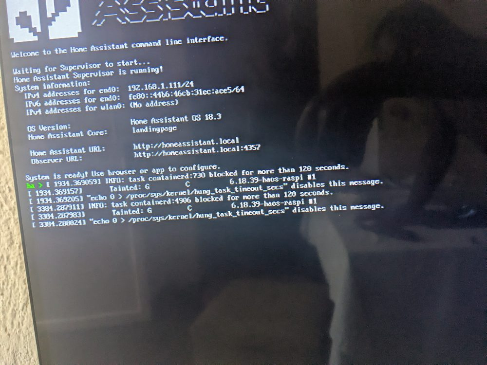

# BEMRA test record

This page collects what we tested, how, and what we saw. It follows one rule: **a result is
listed as passed only if a command, a log or a database row shows it.** Things we observed but
didn't keep evidence for are marked as such, and the gaps are listed at the end.

- Main README: [../README.md](../README.md)
- Earlier detailed backend record (9 Oct 2026): [BEMRA/software/backend/docs/test-results.md](../BEMRA/software/backend/docs/test-results.md)
- Manual procedure to repeat the end-to-end test: [BEMRA/software/backend/docs/testing-e2e.md](../BEMRA/software/backend/docs/testing-e2e.md)

**Environment:** Windows 11, Node.js 24.21.0, PostgreSQL 18.6 (local), Python 3.14, ESP32 Arduino core 3.3.12,
broker `test.mosquitto.org` (1883 plain for the gateway and Home Assistant, 8886 TLS for the backend),
topic root `bemra-dev-01092a`.

---

## 1. Automated tests

Re-run on **15 Oct 2026** for this document.

| Suite | Command | Result |
|---|---|---|
| Backend: unit + integration (real PostgreSQL, `test-*` fixtures cleaned up after) | `npm test` in `BEMRA/software/backend` | **59 passed, 0 failed, 0 skipped** |
| Frontend: domain logic, splash, API integration against mocked endpoints | `npx vitest run` in `BEMRA/software/frontend` | **17 passed** (3 files) |
| Frontend type check | `npx tsc -b` | clean |
| Lint and formatting, both packages | `npm run lint`, `npm run format:check` | clean (after formatting two files on 15 Oct) |
| Backend tests configured only from environment variables, as in CI | `BEMRA_SKIP_ENV_FILE=1` + `DB_*` variables, `npm test` | **59 passed** |
| Frontend production build | `npm run build` | built (one 868 kB JS chunk, mostly ECharts) |

The same steps run in [`.github/workflows/ci.yml`](../.github/workflows/ci.yml) on every push and pull
request, against a fresh PostgreSQL 18 service container. The workflow had not run on GitHub at the
time of writing, because it hadn't been pushed yet.

What the backend suites cover (from [`tests/`](../BEMRA/software/backend/tests)):

| Area | Examples of what is asserted |
|---|---|
| Contract | every sample in `docs/samples/` is valid, and every file in `docs/samples/invalid/` fails for the documented reason; the schema matches the verified ThingSet catalogue; nulls, uint ranges, arrays, timestamps with offsets; the payload is never mutated |
| Topics and decoding | topic parsing, including the removed `summary` topic and the gateway-scoped `status`; no invented timestamps; `rBmsState`/`rErrorFlags` decoding, including unknown bits |
| Ingestion | the full JSONB is preserved; typed columns; cell rows; dedup; `sequence_conflict`; reboot (new `boot_id`); replay ordering; 7 rejection reasons; events; meta; status/LWT dedup; relocation history |
| REST API | health/ready, latest (units, missing fields, freshness), thingset, cells, raw pagination, aggregation, events, HA view, MPM summary, error codes, API-key enforcement, OpenAPI |
| Home Assistant discovery | entity set per device, cell/thermistor count from the layout, templates, availability, private prefix |

---

## 2. Live chain: broker → worker → PostgreSQL → API (9 Oct 2026)

Messages were published to the public broker over TLS (8886) with `npm run mqtt:publish-sample`,
the same payloads as in MQTTX.

| Step | Published | Expected | Observed |
|---|---|---|---|
| a | `status` online (retained) | stored | ✅ `gateway_status` row |
| b | `meta` (retained) | stored, device updated | ✅ firmware v23.1, 4 cells, 2 thermistors, LFP, 6 Ah |
| c | `live` seq 1052 | stored | ✅ `telemetry` + 4 `cell_measurements` |
| d | the same `live` again | duplicate, no new row | ✅ |
| e | `replay` seq 1040 | stored as replay | ✅ `delivery = replay` |
| f | `event` | stored | ✅ `BMS_ERR_CELL_UNDERVOLTAGE`, critical |
| g | `rBmsState` as a string | rejected | ✅ `schema_violation` |
| h | `{not json` | rejected | ✅ `invalid_json` |
| i | device `bms-404` | rejected | ✅ `unknown_device` |

SQL check: the stored `thingset` was deep-equal to the published object. The API returned the
`live` sample (14:30Z) as latest, not the older `replay` (14:18Z), and a 1 h aggregate held both samples.

---

## 3. Reliability experiments

| Experiment | Setup | Result |
|---|---|---|
| Database outage | TCP proxy to PostgreSQL removed while the worker was running; retry budget 3 s | Retries backed off from 250 ms to 2,000 ms; the worker disconnected **without PUBACK**; after the DB came back it reconnected, the broker redelivered, and the row was stored |
| Worker crash | Local broker (Aedes); worker killed with `kill -9`; 2 messages published while it was down | `sessionPresent=true`; both messages stored after restart |
| Public broker, offline subscriber | `clean=false`, QoS 1, subscriber offline during publish (plain mqtt.js, no BEMRA code) | Session resumed but the message **was not delivered**: a limitation of the public broker |
| Persistent session stops receiving (10 Oct) | Same filters, client `bemra-backend-dev` with `clean=false`, versus a fresh clean session, with one probe publish | Persistent session: **0** messages. Clean session: **3** (the probe plus retained `meta` and `status`). Fixed with `MQTT_CLEAN_SESSION=true`; after the change the worker immediately stored the retained gateway status. |
| Ports 1883 vs 8886 | Publish on 1883; subscribers on both | Both received it, so the gateway (1883) and backend (8886) do share messages |

### Keep-alive

| Client keep-alive | 5-minute probe, 3 clients | Conclusion |
|---|---|---|
| 60 s (clean true and false) | Closed by the remote side at 60.8 s and 123.5 s | Something on the path cuts idle connections at about 60 s |
| 30 s | No drops | Backend default set to 30 s; the real worker then held one connection for 3.5 min with no drops |

On the gateway, the first firmware used a 120 s keep-alive, and publishes after a 2-minute idle gap got
no PUBACK. We changed it to 45 s. We also added a GPRS session reset after three MQTT connect failures,
because repeated `err -3` (TCP connect failed) meant the SIM800L's socket was stuck.

---

## 4. UART: simulator → ESP32

| Check | How | Result |
|---|---|---|
| Simulator output format | `py thingset_bms_sim.py --dry-run` | `#mLive {"Meas":{…}}` lines with the 8 contract fields, 4 cells, 2 thermistors |
| Payload size | Simulator model wrapped in the firmware's envelope | **401 bytes** per `live` message (ThingSet line: 203 bytes) |
| Gateway parses and builds messages | Simulator on COM3; gateway logs come back on the same console | Observed during bench sessions: the gateway built telemetry from the reports and attempted to publish (the early attempts are what exposed the "no PUBACK" problem above). *The console logs were not archived.* |
| Firmware build | Arduino IDE, ESP32 Dev Module, core 3.3.12 | Compiled: 332,624 bytes of program storage (25 %) at the last recorded build |

---

## 5. Cellular transport

| Check | Evidence | Status |
|---|---|---|
| Modem init, network registration, GPRS attach on Airtel Rwanda (APN `internet`) | Gateway console during bench sessions (not archived) | Observed |
| MQTT session from the gateway to `test.mosquitto.org:1883` | The backend stored a retained **`offline`** status for `gw-001` with `boot_id` **`0c777ce8`** on 10 Oct 2026. That ID is in the firmware's random 8-hex format, and the payload has exactly the 5 fields of the firmware's `statusJson()`. The broker only publishes a Last Will for a client that had connected, so this proves a cellular MQTT session. | ✅ Verified |
| Telemetry from the gateway stored by the backend | The database holds no telemetry row with a firmware-generated `boot_id`. All telemetry rows so far have boot IDs from the samples (`b7f3a91c`) or hand-written MQTTX tests (`mqttx0001`, `mqttx0002`). On 10 Oct the backend's persistent-session problem (section 3) meant it received nothing during the gateway runs. | ⏳ **Not yet captured** |

**To close this gap:** run `npm start`, start the simulator against the flashed gateway, and wait for two
publish cycles. Then run this query and add the output here:
`SELECT boot_id, sequence, ingested_at FROM telemetry WHERE boot_id ~ '^[0-9a-f]{8}$' AND boot_id <> 'b7f3a91c' ORDER BY id DESC LIMIT 5;`

---

## 6. Home Assistant

| Check | Evidence | Status |
|---|---|---|
| Discovery configs (entities, templates, availability, `expire_after`, private prefix) | Unit tests in `tests/unit/ha-discovery.test.js` | ✅ |
| HA picks up the device and updates from the shared broker | Home Assistant OS 18.3 on a Raspberry Pi; a dashboard on a tablet (photo in the README, 10 Oct 15:35) shows SOC 90 % and 24 V, which match the MQTTX test message `mqttx0002` #7 stored by the backend at 15:29 | ✅ with test payloads |
| HA updated by gateway telemetry over GPRS | — | ⏳ Same gap as section 5 |

---

## 7. REST API and dashboard

| Check | Evidence | Status |
|---|---|---|
| Endpoints answer with correct data and codes | Integration tests; 13 requests from the Postman collection run over HTTP (9 Oct); responses re-captured for the README on 15 Oct | ✅ |
| Hosted deployment | Postman `GET https://bemra-backend.onrender.com/api/v1/openapi.json` with an API key → `200 OK`, 3.49 KB, 22.26 s (likely a cold start) | ✅ |
| Dashboard renders real API data and flags stale data | Headless Edge capture against the local API on 15 Oct: values greyed out, `STALE`, `NOT LIVE`, gateway "no recent data" | ✅ |

---

## 8. Rejections caught in practice

During manual testing the database collected **18 rejected messages** with 6 reasons. Each one was
a real mistake that the checks caught before it reached the telemetry table:

| Reason | Count | Cause |
|---|---|---|
| `sequence_conflict` | 10 | Sequence numbers reused in MQTTX with changed values |
| `schema_violation` | 3 | Deliberately invalid samples (e.g. `rBmsState` as a string) |
| `gateway_mismatch` | 2 | `bms-001` published with `gateway_id: gw-002` |
| `unknown_device` | 1 | Unregistered `bms-404` |
| `identity_mismatch` | 1 | Payload `device_id` differs from the topic |
| `invalid_json` | 1 | `{not json` |

---

## 9. Not verified yet

- Physical Libre Solar BMS C1 on the gateway UART.
- Gateway telemetry over GPRS stored in the database (section 5).
- Offline queueing on a **private** broker with the real gateway (only tested on a local Aedes broker with the worker).
- Graceful shutdown on SIGINT/SIGTERM on Windows.
- Hosted PostgreSQL with TLS and an authenticated private Mosquitto.
- Any MicroPowerManager or Prospect integration.
- Real data usage on the SIM (the ~15 MB/month figure is an estimate).
